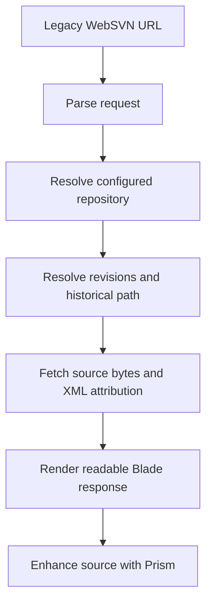

# LaraSVN: product plan and architecture

Status: product plan dated 2 October 2026. Phase 1 local implementation started
19 October 2026. Phase 3 adds comparison, feeds, downloads/raw responses, and
browse aliases. Phase 4 adds deployment configuration, resource controls, local
development tooling, and acceptance guidance. See [PHASE4.md](PHASE4.md) for
current delivered scope. Local browser checks passed on 23 October 2026; remaining
manual acceptance and host checks are recorded in [UAT.md](UAT.md). The supplied
production settings are audited in [PRODUCTION-AUDIT.md](PRODUCTION-AUDIT.md).

## Product goal

Build a read-only Subversion repository browser using Laravel 13 and PrismJS.
The application replaces the deployed WebSVN installation while preserving its
public URLs and repository workflows. The interface can have a new visual design.

The first release targets this installation's configuration, with a documented
compatibility subset. Full support for every WebSVN configuration is outside the
first release. All public endpoint families remain in scope.

The main user tasks are:

- Browse repositories, directories, and files at a selected revision.
- Read source code and Subversion properties.
- Inspect history, commit details, and changed paths.
- Compare file revisions and arbitrary repository paths.
- Find the revision and author responsible for a line.
- Search filenames and history.
- Subscribe to revision feeds and download repository content where enabled.

Success means that existing links reach the equivalent content, source remains
readable without JavaScript, and Prism works correctly across source, diff, and
blame views.

The first release excludes repository writes, repository administration, content
search, legacy template execution, and support for unused configuration variants.
It adds no application login unless confirmed production access rules require it.

## Requirements, evidence, and assumptions

The project requirements are Laravel 13, PrismJS, URL compatibility, and a new
frontend informed by the frontend-design skill. Implementation is not authorized
by this document alone.

Compatibility was assessed against WebSVN 2.9.0. The reference copy is not part
of this project; filenames below refer to that version's source.
The deployed application is at `https://svn.ggpsystems.co.uk/websvn`.
The production version and complete configuration have not been established.

The user supplied the following production evidence:

- An unauthenticated request to
  `/websvn/listing.php?repname=svn-hooks&path=%2F` returned HTTP 200.
- The response displayed the `svn-hooks` root listing at revision 14, with
  author, timestamp, commit message, history, comparison, and RSS navigation.

This confirms anonymous access to that repository listing and revision metadata.
The evidence does not establish access to every path, successful access to every
linked endpoint, or the absence of server-side SVN credentials or authz rules.
The HTTP endpoint also does not reveal whether SVN access uses a local repository
or a remote URL.

The first-release design assumes public browsing without application login.
Before cutover, confirm that every configured repository and path exposed by the
replacement is intended to be public. If production relies on authz restrictions,
permission support becomes required scope before deployment.

Production investigation must remain read-only. Repository inspection is limited
to `svn-hooks` unless the user extends that authorization.

## Compatibility contract

Compatibility means preserving the requested operation, repository, path,
revision semantics, and response type. It does not require identical HTML,
colours, template files, or syntax-highlighting markup.

Existing URLs are real Laravel routes. They return the appropriate response
directly. One URL builder owns links generated by the application so navigation
uses the same deployment prefix and URL style consistently.

The public endpoint families are:

| Endpoint | Required behaviour |
| --- | --- |
| `/`, `index.php` | Repository listing, grouping, and the single-repository redirect |
| `listing.php` | Directory contents, tree navigation, and revision selection |
| `filedetails.php` | Source, properties, MIME-dependent raw responses, and configured compressed responses |
| `log.php` | Path history, pagination, search, revision ranges, and changed-path display |
| `revision.php` | Commit details, changed paths, copy information, and history navigation |
| `diff.php` | Comparison with the previous change to a file, compact or full display, and whitespace handling |
| `comp.php` | Arbitrary file or directory comparison, comparison order, and property changes |
| `blame.php` | Line attribution, revision navigation, and accessible commit details |
| `search.php` | Recursive filename and path search |
| `rss.php` | RSS XML, path and revision selection, entry limits, and quiet mode |
| `dl.php` | File and directory downloads in enabled formats |
| `browse.php` and MultiViews aliases | Repository/path dispatch, `op` selection, and repository switching |

The compatibility inventory must capture the following inputs and behaviour:

- Common parameters: `repname`, `path`, `rev`, and `peg`.
- Diff parameters: `all` and `ignorews`.
- Comparison parameters: `compare[]`, `compare_rev[]`, embedded `path@revision`
  values, and `manualorder`.
- History parameters: `page`, `all`, `isdir`, `showchanges`, `search`, `fr`, `sr`,
  `er`, and `max`.
- Feed parameters: `max`, `quiet`, and `isdir`.
- File and download parameters: `usemime` and `dlmode`.
- MultiViews operation selection, default file/directory dispatch, and deployed
  aliases, including an extensionless `browse` path if used.
- Language selection and preferences used by production. Existing `template`
  parameters must not make an otherwise valid content URL fail, but old templates
  are not rendered.
- Existing line and directory fragments, including blame's `#lN` anchors,
  GeSHi-generated source anchors, and directory anchors generated by
  `anchorForPath()`.
- Request methods, omitted values, defaults, redirects, and error responses.

The parser handles encoded paths and array parameters explicitly. Laravel request
normalization must not trim meaningful whitespace from repository paths. Decoding
and normalization must not turn a valid filename into a different resource.

The configuration subset is defined from production evidence before cutover.
It includes repository names and groups, repository subpaths, the deployment
prefix, URL style, language, encodings, MIME rules, downloads, and issue links
where enabled. Unsupported settings are listed explicitly. Configuration import
must report unsupported access restrictions rather than ignore them.

Legacy defects are not a compatibility target. Corrected behaviour, deliberate
security differences, and unsupported options are recorded as deviations.

## Architecture decisions

Use one Laravel application with Blade-rendered pages and small JavaScript
modules. Subversion remains the source of truth. The application does not mirror
repository history into a database.

Blade fits the product's main interactions: navigation, revision selection,
search, and reading. It also allows source and attribution to remain available
when JavaScript fails. A separate SPA and JSON API would add routing and state
contracts without a current product need.

Wrapping the old scripts inside Laravel would retain the global configuration
and GeSHi coupling. The replacement implements the browser behaviour through new
owners and uses the old application as a compatibility reference.

The proposed ownership is:

| Owner | Responsibility |
| --- | --- |
| Compatibility parser and URL builder | Interpret legacy requests and generate deployment-compatible links |
| Repository configuration | Map public names to administrator-configured SVN locations and capabilities |
| Subversion client | Execute commands safely, parse machine-readable results, fetch bytes, and expose typed failures |
| History logic | Resolve endpoint-specific revision defaults, copy history, historical paths, and previous/next changes |
| Comparison builder | Produce hunks, line alignment, property changes, and binary-file results |
| Download builder | Export allowed content, build archives, stream responses, and clean up temporary resources |
| Controllers and response builders | Coordinate the requested operation and select HTML, XML, raw, or download responses |
| Blade components and code-view JavaScript | Render navigation, tables, source lines, attribution, and Prism tokens |

These owners can be concrete classes. Single-implementation interfaces, provider
frameworks, and generic repository abstractions are unnecessary.

Repository configuration lives in Laravel configuration, with secrets supplied
through the deployment environment. File-based framework state can support the
initial release. A database, Redis, persistent SVN index, and queue workers are
not baseline requirements.

## Domain model and request flow

The important concepts are:

| Concept | Meaning |
| --- | --- |
| Repository | Public identity, configured SVN location, optional exposed subpath, and enabled capabilities |
| File location | Repository, path, operative revision, and peg revision |
| Resolved location | The concrete revisions and historical path used for an operation |
| Source document | Original bytes, decoded display text, encoding, line boundaries, and final-newline state |
| History entry | Revision, author, timestamp, message, changed paths, and copy information |
| Comparison | Two source locations, hunks, old/new line references, and non-text changes |
| Blame result | A source document and attribution keyed by its line numbers |

The operative revision selects content. The peg revision identifies path history
across copies and moves. Those values remain separate throughout the system.
An absent side of an addition or deletion is explicit, not an SVN process failure.

A legacy blame URL follows this flow:

Endpoint defaults remain explicit. A file's latest change and the repository's
HEAD are different values. `diff.php` selects the previous change to that file,
not automatically the immediately preceding repository revision.

For each operation, resolve symbolic or omitted revisions once and reuse the
concrete values for all subsequent reads. A commit during a request must not mix
source and attribution from different revisions.

Use the SVN CLI for repository transport and history. Prefer XML output for
metadata and blame. Comparisons use SVN diff output where it provides the
required result, with source documents fetched separately for display.
Directory comparison includes property-only changes and binary files.

Unknown repositories, missing paths, invalid requests, unavailable SVN services,
and process failures have explicit responses. Public errors do not expose command
arguments, credentials, or server filesystem paths.

## Prism, diff, and blame

Prism owns syntax colouring. It does not discover revisions, compute repository
changes, or assign blame.

The local implementation couples these jobs. `getFileContents()` in
`include/svnlook.php` can return highlighted HTML.
`diff.php` fetches raw and highlighted copies, and
`include/diff_util.php` handles HTML tags and
entities while calculating inline changes. `blame.php`
joins highlighted lines with human-readable blame output.

The replacement uses the following rendering contract:

1. Obtain complete source documents independently of highlighting.
2. Build comparison rows or blame attribution from original source and metadata.
3. Tokenize each complete display document with Prism.
4. Split the token tree at line boundaries while preserving nested token classes.
5. Render those lines with independent gutters, change markers, and attribution.

Full-document tokenization preserves multiline comments, strings, heredocs, and
embedded languages. Tokenization of isolated lines or visible hunks cannot
preserve that context. The renderer does not split highlighted HTML strings.

Each side of a diff has its own tokenization and original line numbers. Compact
display hides unchanged context after tokenization. Full display restores the
document's unchanged lines. Whitespace comparison changes equality rules without
rewriting the displayed source.

Word-level changes are a separate presentation calculation over paired changed
lines. `jsdiff` is the proposed small dependency for that calculation, subject to
the initial proof. Prism token ranges and word-change ranges use one documented
character-coordinate system so Unicode cannot shift change markers.

Blame uses XML line attribution and source fetched at the same resolved revision.
Revision details remain available through links and keyboard-accessible controls.
Missing attribution is explicit. Attribution and source line counts must agree.

The renderer preserves tabs, blank lines, Unicode, and final-newline state.
Downloads retain original bytes even when display requires character decoding.
Unknown grammars and enhancement failures retain plain text. Large-file limits
can disable highlighting, but must not silently truncate content or change a
requested comparison into an incomplete result.

Prism and its supported grammars are bundled locally. A CDN is unnecessary.
Worker-based highlighting or additional caching requires measured evidence.

## Frontend direction

The interface is modern with a light touch: restrained surfaces, readable
typography, compact controls, and clear hierarchy. Light, Dark, and System
appearance preferences are required. System is the default, follows operating
system changes, and remains distinct from an explicit Light or Dark choice.

[DESIGN.md](DESIGN.md) records the pre-implementation visual guidance and appearance
contract. The local ProjectSend 2.6.0 source has informed its guidance on neutral
surfaces, action hierarchy, compact tables, and appearance preferences. It is a
design reference, not a UI to replicate or a reason to adopt React/Inertia.
The staff account dashboard is the primary reference because it is the surface
the user knows and prefers. Shell geometry remains provisional while a
staff-inspired collapsible navigation rail is compared with a compact header.
Rendered reference review and exact palette and typography choices remain open.

Repository, path, and revision stay visible across views. Source, history, diff,
and blame use consistent navigation and revision controls. Tables support long
paths and authors without losing their actions or accessible names.

Desktop diff uses aligned columns. Narrow screens use a unified reading layout.
Line numbers and addition/deletion markers retain meaning without colour.
Source selection and copying must not include gutter or attribution text.

The baseline is WCAG 2.2 AA, with semantic controls, visible focus, sufficient
contrast, keyboard access, operable scrollbars, and readable error states.
Commit details cannot require hover. Empty results, unavailable files, binary
content, timeouts, and highlighting failures each receive a useful state.

During implementation, extend `DESIGN.md` with accepted tokens and their runtime
mapping. A short `UX-CONTRACT.md` can record shared navigation, URL state,
scrolling, localization, and interaction behaviour. The initial local proof and
its original verification limits are recorded in [PHASE1.md](PHASE1.md). Current
browser results and remaining manual checks are recorded in [UAT.md](UAT.md).

## Operational boundaries

The application exposes read operations only. It does not provide commit,
repository administration, or account-management workflows.

SVN targets come from administrator configuration, not arbitrary request URLs.
The client uses argument-based process execution, bounded execution time, and
safe parsing. Path resolution cannot escape an exposed repository subpath.
Secrets remain outside responses and public logs.

Repository source, properties, names, and commit messages are untrusted display
content. Raw active-content responses require an explicit isolation or restrictive
response policy. Any difference from legacy MIME behaviour is documented and
checked against the deployed use cases.

Downloads respect configured capabilities. Export and archive operations use
isolated temporary directories, avoid dereferencing symlinks, define SVN external
handling explicitly, and clean up after success, failure, or interrupted delivery.
Concurrent requests do not share writable export directories or filenames.

Persistent response caching is deferred. Future caches must account for
repository identity, resolved revisions, peg, response options, and access scope.
Commit metadata can change through revision properties, so a revision number alone
does not establish that every response is immutable.

If permission support becomes necessary, it must cover listings, both comparison
sides, historical paths, feeds, downloads, and commit metadata. The reference
`getLog()` redacts information when changed paths are unreadable. A route-level
login check would not preserve that behaviour.

Any reuse of WebSVN code, translations, or assets must preserve applicable GPL
notices and compatible distribution terms.

## Delivery milestones

Milestones describe future implementation work. Each milestone has an observable
exit condition rather than a calendar estimate.

| Milestone | Deliverable | Exit condition |
| --- | --- | --- |
| 1. Deployment and compatibility inventory | Production settings, representative request corpus, documented supported configuration, and Laravel 13 runtime requirements | Required URLs, response types, repository exposure, and unresolved settings are recorded |
| 2. Source, diff, and blame proof | Small SVN fixture, source-document model, full-document Prism renderer, line comparison, and XML attribution | Multiline syntax, Unicode, line alignment, and attribution pass together |
| 3. Browsing and history | Shared shell, repositories, directories, source properties, logs, revision details, and search | Legacy URLs support complete browsing and history workflows |
| 4. Remaining endpoint behaviour | Arbitrary comparisons, RSS, raw responses, downloads, and deployed MultiViews aliases | Every endpoint family passes its compatibility cases |
| 5. Release validation and cutover | Production configuration, browser checks, deployment instructions, and rollback procedure | Agreed request corpus and operational checks pass before switching traffic |

The early Prism proof is the main architectural risk check. Broader screen work
does not proceed on the assumption that ordinary file highlighting proves diff
and blame correctness.

## Acceptance and verification

Use a disposable local SVN repository for automated cases. Production inspection
is supplemental evidence and remains restricted to `svn-hooks`.

The fixture includes these cases:

- A file changes at r10 and r20, with unrelated commits between them. A diff at
  r20 selects r10 as the previous file change.
- Files are copied, renamed, deleted, and recreated at the same path. Operative
  and peg revisions select the intended history.
- Multiline comments, heredocs, and embedded languages cross diff context and
  blame grouping boundaries.
- Empty files, blank lines, tabs, CRLF, Unicode, supported legacy encodings, and
  missing final newlines preserve content and line numbers.
- Paths contain spaces, `@`, non-ASCII characters, and URL-sensitive characters.
- Comparisons include additions, deletions, binary files, and property-only changes.
- Invalid parameters, absent resources, SVN failures, and archive failures produce
  explicit responses with no leaked secrets or partial-success claims.
- Concurrent downloads use independent temporary resources and leave no files
  behind after delivery or failure.

Run the same request corpus against the reference and the replacement where
practical. Compare repository data, revision choices, ordering, pagination,
statuses, redirects, headers, feed entries, raw bytes, and archive contents.
Do not compare whole HTML pages or require byte-identical compressed archives.
Directory comparison checks include property changes. Download checks include
symlink handling, filenames, archive layout, and content bytes.

Browser checks cover source, compact/full diff, whitespace toggles, blame links,
line fragments, filename search, history search, and revision navigation. Checks
include keyboard use, a narrow viewport, long content, JavaScript disabled, and
failed highlighting. Reconstructed highlighted text must equal the display source.
Appearance checks cover both themes, saved overrides, System tracking, first
paint, and contrast between syntax colours and diff marks, as defined in
[DESIGN.md](DESIGN.md).

The release is ready only when every required endpoint has a passing case, the
configuration subset and deviations are documented, and production repository
exposure has been confirmed.

## Cutover and rollback

Run the replacement alongside WebSVN with equivalent repository configuration.
Validate URLs under the intended `/websvn` prefix, including web-server handling
of `.php` paths and any MultiViews aliases. The server must route those paths to
Laravel rather than attempt to execute matching legacy scripts.

Switch the web-server target after acceptance checks pass. Retain the previous
application and configuration for rollback. Because repository data remains in
SVN and the replacement performs no repository writes, rollback requires no
repository migration. Temporary files and any framework state remain isolated
between deployments.

## Open deployment details

The remaining details are:

- Production WebSVN version, repository registration, groups, exposed subpaths,
  and local or remote SVN transport.
- Whether restrictions exist beyond the anonymously accessible `svn-hooks` listing.
- Download enablement and formats, MIME behaviour, issue links, language settings,
  and configured character encodings.
- Actual use of MultiViews, aliases, fragments, and request methods.
- Available PHP version, extensions, SVN tools, process permissions, and deployment
  method. Laravel 13 requirements must be checked against official documentation.
- Representative file sizes and response times for sensible execution and
  highlighting limits.

These are implementation and deployment inputs. They do not require adding
speculative features to the architecture.

## Reference implementation

The main source references are:

- `include/configclass.php`: repository
  configuration, URL generation, download capabilities, and access checks.
- `include/setup.php`: request defaults, revision
  parsing, language preferences, and MIME configuration.
- `multiviews.php`: MultiViews dispatch.
- `include/svnlook.php`: SVN commands, XML
  metadata, source retrieval, highlighting, and history redaction.
- `diff.php`,
  `include/diff_inc.php`, and
  `include/diff_util.php`: previous-change
  selection, hunk rendering, line pairing, and inline changes.
- `blame.php` and
  `comp.php`: attribution and arbitrary comparisons.
- `filedetails.php`,
  `rss.php`, and `dl.php`: raw responses,
  feed output, export, and archive behaviour.
